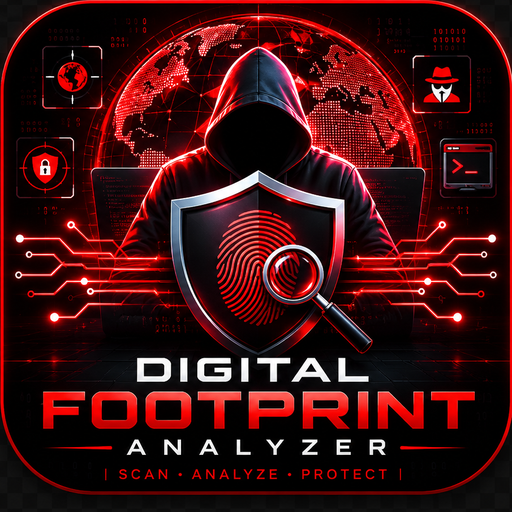

# 🔍 Digital Footprint Analyzer (CyberTrace OSINT)

<p align="center">
  
</p>

<p align="center">
  <strong>Next-Generation OSINT Reconnaissance & Digital Identity Exposure Engine</strong><br />
  <em>Automated Handle Discovery • Attack Surface Mapping • Threat Exposure Scoring • Multi-Platform Intelligence</em>
</p>

<p align="center">
  <a href="https://digital-footprint-analyzer-5501.onrender.com"></a>
  <a href="LICENSE"></a>
  <a href="#"></a>
  <a href="#"></a>
  <a href="#"></a>
</p>

---

## 🌐 Live Web Application

🚀 **Experience the Live Cloud Dashboard:**  
👉 **[https://digital-footprint-analyzer-5501.onrender.com](https://digital-footprint-analyzer-5501.onrender.com)**

---

## 📌 Overview

**Digital Footprint Analyzer (CyberTrace OSINT)** is a high-speed defensive intelligence and open-source intelligence (OSINT) platform engineered to identify, catalog, and evaluate a target's digital footprint across the public internet.

By querying over **300+ digital platforms, code registries, social networks, gaming ecosystems, and developer hubs simultaneously**, the engine correlates public identities, uncovers orphaned digital profiles, maps an entity's external attack surface, and calculates an **Exposure Risk Index**.

### Available Execution Modes:
1. **Cloud Web Dashboard**: Fast, mobile-responsive Flask web application hosted on Render with live async scanning.
2. **Progressive Web App (PWA)**: Installable directly on Windows, macOS, Android, and iOS with offline service worker capabilities.
3. **Desktop Native Client (`desktop_app.py`)**: Local GUI window for offline analysis without browser overhead.
4. **Command-Line CLI (`main.py`)**: Headless terminal engine for automated red/blue team reconnaissance pipelines.

---

## ⚡ Key Capabilities

```
                       ┌─────────────────────────┐
                       │   Target Handle / Alias │
                       └────────────┬────────────┘
                                    │ Multi-Threaded Query Pool
                 ┌──────────────────┼──────────────────┐
                 ▼                  ▼                  ▼
       ┌──────────────────┐┌──────────────────┐┌──────────────────┐
       │  Social & Media  ││ Developer & Code ││ Gaming & Forums  │
       │  (GitHub, X, IG) ││ (GitLab, Kaggle) ││ (Steam, Discord) │
       └─────────┬────────┘└────────┬─────────┘└────────┬─────────┘
                 │                  │                   │
                 └──────────────────┼───────────────────┘
                                    ▼
                      ┌───────────────────────────┐
                      │ Response Parsing & Filter │
                      │  (Status Codes & Headers) │
                      └─────────────┬─────────────┘
                                    │
                                    ▼
                      ┌───────────────────────────┐
                      │ Risk Index Calculation    │
                      │ & Forensic Report Engine  │
                      └─────────────┬─────────────┘
                                    ▼
                 ┌──────────────────┴──────────────────┐
                 ▼                                     ▼
      📄 Detailed HTML Report               📊 Executive Text Summary
```

- **⚡ Multi-Threaded Asynchronous Scanning**: Queries hundreds of endpoints concurrently with adaptive timeouts to bypass rate-limits.
- **🛡️ 300+ Platform Coverage**: Comprehensive signature database spanning social networks, technical repositories, discussion forums, gaming networks, and finance hubs.
- **🎯 Accurate Pattern Matching**: Uses status-code heuristics, redirect detection, and error-page fingerprinting to eradicate false positives.
- **📊 Forensic Threat Reporting**: Automatically compiles structured forensic audit reports in both rich **HTML** and clean **TXT** formats.
- **📱 Progressive Web App (PWA)**: Complete with `manifest.json` and service worker (`sw.js`) for standalone desktop and mobile installation.

---

## 🗺️ Categorized Platform Matrix

| Category | Representative Target Platforms |
|---|---|
| **Tech & Developer** | GitHub, GitLab, Bitbucket, StackOverflow, Kaggle, DockerHub, Replit, Codechef, LeetCode |
| **Social Networks** | Twitter / X, Instagram, LinkedIn, Reddit, Pinterest, Tumblr, Medium, TikTok |
| **Messaging & Voice** | Telegram, Discord, Skype, WhatsApp Channels, Matrix |
| **Gaming & Communities**| Steam, PlayStation Network, Xbox Live, Twitch, Roblox, Chess.com |
| **Design & Creative** | Behance, Dribbble, ArtStation, DeviantArt, SoundCloud, Spotify |
| **Crypto & Finance** | TradingView, Keybase, OpenSea, Binance Feed |

---

## 🛠️ Tech Stack & Architecture

- **Backend Core**: Python 3.10+ • Flask • Requests • Concurrent Futures
- **Frontend Engine**: Cyber-themed HUD • HTML5 • Modern CSS3 Grid/Flex • Vanilla JS
- **Application Delivery**: Waitress WSGI Server • Docker Containerization • Render Cloud
- **Packaging & PWA**: Web App Manifest • Service Worker Cache • PyInstaller Desktop Wrapper

---

## 🚀 Installation & Local Setup

### 1. Prerequisites
- Python 3.10 or higher installed:
  ```bash
  python --version
  ```

### 2. Clone Repository
```bash
git clone https://github.com/ArnabHalder-CS/digital-footprint-analyzer.git
cd digital-footprint-analyzer
```

### 3. Install Dependencies
```bash
pip install -r web/requirements.txt
```

### 4. Run Web Dashboard
```bash
python web/app.py
```
Open your browser at: **`http://localhost:5000`**

### 5. Run via Command Line (CLI Mode)
```bash
python main.py
```

---

## ☁️ Cloud Deployment (Render)

The project includes native **`render.yaml`** configuration for zero-friction blueprint deployment:

```yaml
services:
  - type: web
    name: digital-footprint-analyzer
    runtime: python
    region: singapore
    plan: free
    branch: main
    buildCommand: pip install -r web/requirements.txt
    startCommand: python web/app.py
    envVars:
      - key: PORT
        value: 5000
```

To deploy your own instance:
1. Connect your repository to **[Render.com](https://dashboard.render.com/)**.
2. Select **Blueprints** and choose `digital-footprint-analyzer`.
3. Click **Apply** — Render deploys the web service automatically.

---

## 📁 Repository Structure

```
digital-footprint-analyzer/
├── main.py                     # Command-line entry point & CLI scanner
├── test_connection.py          # Platform connectivity diagnostic tool
├── procfile                    # Process file for Heroku/Render hosting
├── render.yaml                 # One-click Render cloud deployment spec
├── data/
│   ├── platforms.py            # Comprehensive 300+ target platform signature database
│   └── __init__.py             # Data package initialization
├── web/
│   ├── app.py                  # Flask web application & REST API routes
│   ├── desktop_app.py          # Native desktop GUI wrapper
│   ├── requirements.txt        # Production dependency manifest
│   ├── templates/
│   │   └── index.html          # Cyber-themed OSINT command dashboard
│   ├── static/
│   │   ├── css/style.css       # Responsive cyberpunk stylesheet
│   │   ├── js/script.js        # Dynamic scanner controller & DOM renderer
│   │   ├── manifest.json       # PWA manifest metadata
│   │   └── sw.js               # Service Worker for offline/PWA caching
│   └── icons/                  # High-resolution logos & PWA icons
└── README.md                   # Technical specification & project documentation
```

---

## ⚖️ Ethical Use & Disclaimer

> **IMPORTANT:** This software is designed strictly for **authorized security audits, defensive personal footprint auditing, and educational research**.  
> Users are solely responsible for compliance with local and international cyber laws. The authors assume no liability for misuse or actions that violate the terms of service of target platforms.

---

## 👨‍💻 Author

**Arnab Halder**  
- GitHub: [@ArnabHalder-CS](https://github.com/ArnabHalder-CS)  
- Focus: Cyber Security, Threat Intelligence & OSINT Automation
